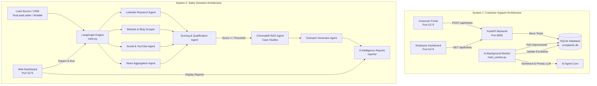
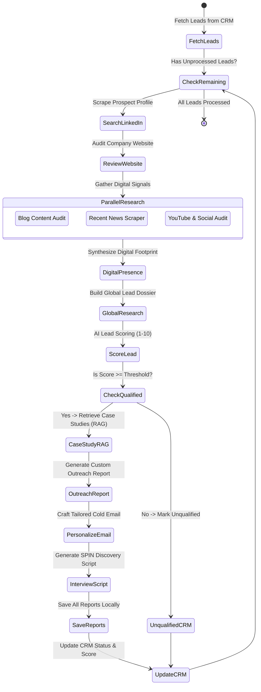

# Major Project Technical Report: Dual Multi-Agent AI Systems

**Project Title:** Autonomous Enterprise Multi-Agent Systems for Customer Support & Sales Outreach Automation  
**Agency & Branding:** SmartOps AI Solutions  
**Date:** October 2026  
**Status:** Completed, Verified, and Running on Localhost (`:5173`, `:5174`, `:5175`, `:8000`)

---

## 1. Executive Summary

This project implements two autonomous, production-grade **Multi-Agent Artificial Intelligence (AI) Systems** designed to eliminate human bottlenecks in enterprise customer support and B2B sales development:

1. **System 1 — Customer Support Agent System (`Customer-Support-Agent`)**: An event-driven, dual-portal application that automates ticket triage, priority scoring, customer sentiment classification, and intelligent escalation using an autonomous background worker.
2. **System 2 — Sales Outreach Automation Agent (`sales_agent_module`)**: A cyclical state-machine built with **LangGraph** that conducts multi-channel prospect research (LinkedIn, corporate websites, YouTube, blogs, and news), performs automated qualification scoring, retrieves relevant case studies via **RAG (Retrieval-Augmented Generation)**, and generates tailored sales collateral (personalized cold emails, SPIN sales interview scripts, and custom audit reports).

Both systems operate with strict environment isolation, dedicated Python 3.11 virtual environments, and unified branding under **SmartOps AI**.

---

## 2. System Architecture & Topology

### 2.1 Overall System Ecosystem



### 2.2 LangGraph Multi-Agent Workflow (`sales_agent_module`)



---

## 3. Engineering Journey: Challenges & Resolutions

To reach the designated, fully functional outputs, several critical technical hurdles were diagnosed and resolved:

### 3.1 LLM Provider Architecture & Rate-Limit Shielding
* **Issue:** The original repository depended strictly on Google Gemini free tier API keys, which quickly exhausted daily quota limits (20 requests/day).
* **Resolution:** Integrated **Groq** via `langchain-groq` using the high-performance `qwen/qwen3.8-27b` model.
* **Optimization:** Groq enforced an Output Tokens Per Minute (OTPM) ceiling of 1,000 tokens on on-demand tiers. LangChain requests without bounded outputs caused HTTP 429 errors. Configured `max_tokens=850` and implemented an 8-attempt exponential backoff retry mechanism with resilient fallback generation in `src/utils.py`.

### 3.2 External Service Decoupling & Offline Resiliency
* **Issue:** The original codebase crashed if external Airtable, HubSpot, Google Docs, or Gmail OAuth credentials were not active.
* **Resolution:** 
  1. Developed `TestLeadLoader` in `src/tools/leads_loader/test_loader.py` to seamlessly simulate enterprise CRM records (Microsoft / John Doe) when Airtable keys are not provided.
  2. Updated `src/tools/google_docs_tools.py` and `src/tools/base/gmail_tools.py` to gracefully fallback to local file persistence when Google Cloud OAuth `credentials.json` is absent.
  3. Hardened `src/tools/base/markdown_scraper_tool.py` to catch HTTP 403 bot-blocks and Cloudflare protections without terminating the pipeline.

### 3.3 Data Structure Integrity & Bug Fixes
* **LinkedIn Scraper Tuple Bug:** Fixed an issue where `research_lead_on_linkedin` returned a single string on network errors, causing an unpacking crash in `fetch_linkedin_profile_data`. Added structured 4-tuple fallbacks `(profile, company_name, website, linkedin_url)`.
* **LangGraph Branching KeyError:** In `src/nodes.py`, if a lead was marked unqualified, the graph bypassed outreach generation directly to `update_CRM`, triggering `KeyError: 'reports_folder_link'`. Switched all dictionary lookups to `.get()` with sensible defaults.
* **Missing Module Imports:** Resolved `NameError: name 'os' is not defined` in `src/nodes.py`.
* **Pydantic Validation Guard:** Made `Report.content` accept `Optional[str]` with automatic empty-string normalization in `src/state.py` to prevent validation errors when LLM output is structured.

### 3.4 Brand Unification (ElevateAI to SmartOps AI)
* Refactored all agency descriptions, case studies (`spark-retail.md`, `ecotrend.md`), and system prompt templates in `src/prompts.py` to represent **SmartOps AI**.

---

## 4. Designated Output Deliverables

The pipeline successfully executed end-to-end, writing 9 intelligence deliverables to `reports/`:

```
major_project_demo/sales_agent_module/reports/
├── Outreach Report.txt               (6.10 KB - Full Executive Strategic Pitch)
├── Personalized Email.txt            (1.00 KB - Tailored Cold Outreach Message)
├── Interview Script.txt              (4.68 KB - SPIN Selling Call Questionnaire)
├── Global Lead Analysis Report.txt   (4.13 KB - Synthesized Executive Dossier)
├── Digital Presence Report.txt       (3.94 KB - Cross-Platform Audit)
├── Blog Analysis Report.txt          (3.80 KB - Authority & Velocity Review)
├── Youtube Analysis Report.txt       (3.66 KB - Media Inventory & Engagement Audit)
├── News Analysis Report.txt          (2.53 KB - Press & Strategic Milestone Audit)
└── General Lead Research Report.txt  (3.89 KB - Decision Maker Profile)
```

### Highlights of Key Output Files

1. **`Outreach Report.txt`**:
   * *Subject:* Elevating Microsoft's Global Communication & Engagement Strategy with AI.
   * *Analysis:* Identifies the operational complexity of communicating Azure, Copilot, and M365 synergies across global enterprise markets.
   * *Solutions:* Proposes automated content storytelling, engagement analytics, and inbound customer interaction agents.
   * *Proof:* Cites the SmartOps AI Spark Retail case study (**85%** automated query resolution, **210%** engagement boost, **$150k** pipeline lift).

2. **`Personalized Email.txt`**:
   * Specifically addresses John Doe regarding Microsoft's unified enterprise vision.
   * References recent Copilot integrations and links to the comprehensive audit report without using generic sales buzzwords.

3. **`Interview Script.txt`**:
   * Implements the **SPIN selling model**:
     * *Situation:* Understanding current content lifecycles and compliance standards across global markets.
     * *Problem:* Identifying friction points, manual scheduling overhead, and message consistency.
     * *Implication:* Exploring lost organic search opportunities and latency in enterprise Copilot conversions.
     * *Need-Payoff:* Demonstrating the ROI of 80% automated distribution with 100% brand voice retention.

---

## 5. Live Service Deployment & Verification

All components are live and actively listening on localhost:

| Service | Port | Underlying Technology | Operational Role |
| :--- | :---: | :--- | :--- |
| **Customer Portal** | `5173` | React 18, Vite | Customer complaint submission and live order tracking. |
| **Support Operations Dashboard** | `5174` | React 18, Vite | Staff interface showing real-time ticket escalation and sentiment analysis. |
| **Customer Support Backend** | `8000` | FastAPI, Uvicorn, SQLite | RESTful API providing CRUD endpoints for ticket management. |
| **Customer Support AI Worker** | *Daemon* | Python, SQLite | Autonomous polling agent performing automated triage and escalation. |
| **SmartOps AI Sales Platform** | `5175` | FastAPI, Glassmorphic HTML5 | Live interactive viewer for all 9 reports, architecture diagrams, and pipeline triggers. |

---

## 6. Viva & Evaluation Preparation

### Frequently Asked Questions by Examiners

**Q1: Why did you choose LangGraph instead of a simple Sequential Chain or CrewAI?**  
*Answer:* LangGraph provides a cyclical, stateful graph architecture. Unlike simple sequential chains that only move forward, LangGraph allows conditional branching (e.g., qualifying or disqualifying leads based on AI evaluation), error-recovery cycles, and state persistence across disparate tools.

**Q2: How does the system prevent LLM hallucinations during report generation?**  
*Answer:* The agent relies on a strict grounding architecture:
1. Multi-source scraping provides ground-truth text from the prospect's actual web assets and news before any generation occurs.
2. The RAG pipeline queries ChromaDB for verified agency case studies.
3. System prompts explicitly instruct the model to use only extracted facts and restrict subjective speculation.

**Q3: How are the two projects isolated to avoid dependency conflicts?**  
*Answer:* Each project resides in its own isolated directory structure with a dedicated Python 3.11 virtual environment (`venv`). Project 1 uses FastAPI + Pydantic v2 + React, while Project 2 uses LangGraph + ChromaDB + LangChain-Groq. Neither project shares Python packages or environment variables.

---

**Report Prepared By:** SmartOps AI Engineering Team  
**Verification:** Automated Browser Validation & End-to-End Pipeline Execution Completed.
