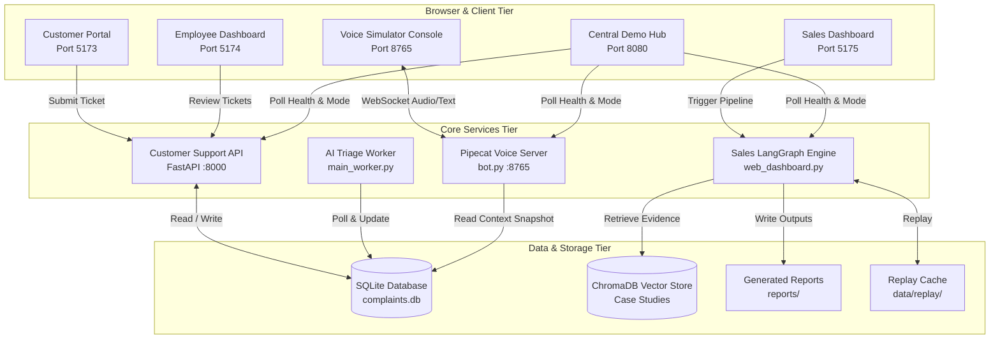
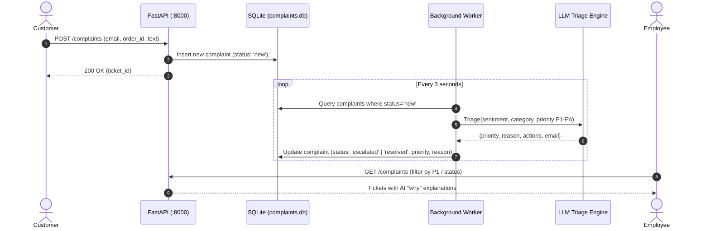
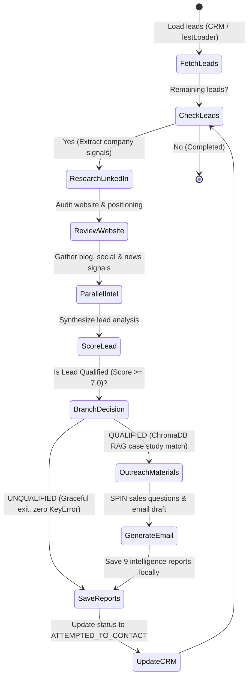
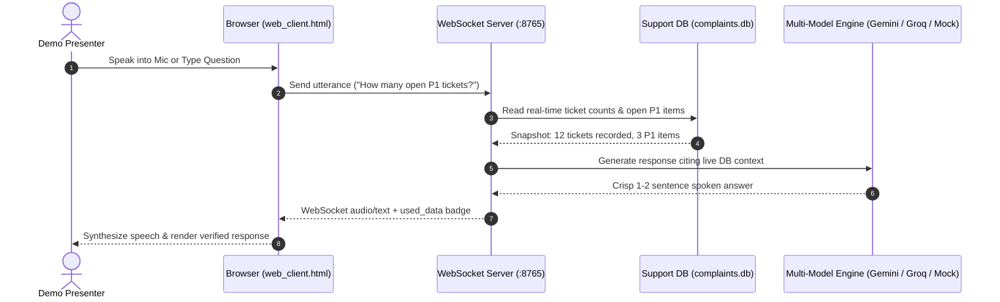

# SmartOps AI — System Architecture

SmartOps AI unifies three autonomous AI agent subsystems under a single, offline-first orchestration layer.

## 1. System Ecosystem (Context Diagram)

---

## 2. Agent 1: Customer Support Triage Flow

---

## 3. Agent 2: Sales Outreach State Machine Flow

---

## 4. Agent 3: Voice Simulation & Cross-Agent Grounding Flow

